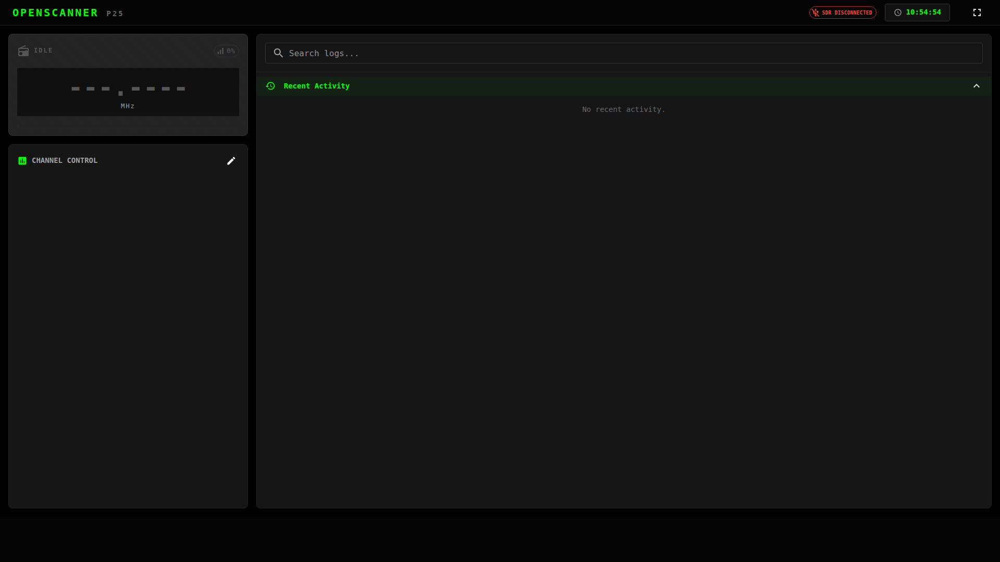

# OpenScanner

[](https://github.com/briannippert/OpenScanner/actions/workflows/dotnet.yml)
[](https://github.com/briannippert/OpenScanner/actions/workflows/frontend.yml)

OpenScanner is a high-performance, web-based digital radio scanner designed for the Raspberry Pi (optimized for Pi 5). It combines a robust **.NET backend** with a modern **React frontend** to provide real-time P25 digital voice decoding, live spectrum analysis, and AI-powered transcriptions.



## Key Features

- **Digital Voice Decoding**: Stable P25 Phase 1 decoding via `rtl_fm` and `dsd-fme`.
- **AI Transcriptions**: Integrated **Whisper AI** (`whisper.cpp`) for automatic speech-to-text logging.
- **Fire Tone Out Detection**: Detects and alerts on specific 2-tone paging sequences (e.g., Fire/EMS dispatch).
- **Real-Time Synchronization**: State (locks, holds, status) is synced instantly across all connected browsers.
- **Modern Dashboard**:
    - **Live Waterfall**: Visual scrolling spectrogram of decoded audio.
    - **Transmission History**:
        - **Hierarchical Tree View**: Organize logs by Year, Month, Day, and Channel for easy browsing of massive datasets.
        - **Live Activity**: A dedicated "Recent Activity" section for monitoring incoming transmissions in real-time.
        - **Integrated Search**: Powerful search bar to find transmissions by transcription text, channel names, or frequencies.
        - **Instant Playback**: One-click listening for all recorded transmissions.
    - **Channel Management**: Full database control to add, edit, or delete channels. Includes frequency hold and scan resume.
- **GPS Integration**: Live tracking of location, altitude (Imperial units), and satellite count.
- **Swagger Documentation**: Full OpenAPI/Swagger UI for API exploration.
- **Service-Ready**: One-line installer sets OpenScanner up as a systemd service on ports 80/443, with in-app updates from prebuilt releases.

## Hardware Requirements

- **Raspberry Pi**: (Pi 5 highly recommended for Whisper AI performance).
- **RTL-SDR Dongle**: (RTL2832U based, such as RTLSDRv3 or v4).
- **GPS Receiver**: (Optional, any USB GPS receiver compatible with `gpsd`).
- **Antenna**: Tuned for your local 150-800MHz public safety bands.

## Quick Start

### 1. Install
One command installs the latest release — no repo clone, .NET SDK or Node needed on the device:

```bash
curl -fsSL https://github.com/briannippert/OpenScanner/releases/latest/download/install.sh | sudo bash
```

The installer downloads the prebuilt release for your CPU (64-bit ARM or x86-64) and verifies its checksum, installs the required system libraries, builds the radio decoders (DSD-FME, mbelib) from source, sets up Whisper AI, and registers the `openscanner` systemd service. It needs a Debian-based 64-bit OS (Raspberry Pi OS, Ubuntu, Debian).

### 2. Access the UI
Once installed, open your browser to:
`http://<your-pi-ip>`

For API documentation, visit:
`http://<your-pi-ip>/swagger`

## Installation Options

Pass options after `bash -s --`, e.g. `curl -fsSL …/install.sh | sudo bash -s -- --version v0.1.300`.

- `--version <tag>`: install a specific release instead of the latest.
- `--tarball <path>`: install from a release tarball you already downloaded (offline installs).
- `--deps-only`: install the system libraries and radio decoders, then stop.
- `--no-model`: skip pre-downloading the Whisper model (the server fetches it on first use).

Everything lives under `/opt/openscanner`:

| Path | Contents | Kept across updates |
|---|---|---|
| `app/` | The installed release (server, web client, whisper-cli) | Replaced |
| `app.prev/` | The previous release, for rollback | Replaced |
| `data/` | Database, recordings, IQ samples | Yes |
| `certs/` | Self-signed HTTPS certificate | Yes |
| `whisper/models/` | Whisper models | Yes |
| `config/appsettings.json` | Your overrides of the server's `appsettings.json` | Yes |

## Running on macOS

OpenScanner also runs on macOS (Apple Silicon and Intel) for development and desktop use. The macOS setup script uses **Homebrew** to install dependencies, builds whisper.cpp and DSD-FME from source, builds the app, and prints how to run it. macOS has no systemd, so it does **not** install a background service.

```bash
git clone https://github.com/briannippert/OpenScanner.git
cd OpenScanner
chmod +x scripts/*.sh

# Installs deps (Homebrew + .NET 10 + whisper.cpp + dsd-fme) and builds the app
./scripts/install_mac.sh

# Dependencies only:
./scripts/install_mac.sh --deps-only
```

Then run the app and open `http://localhost:8080` (Swagger at `/swagger`):

```bash
cd server/OpenScanner.Server
dotnet run -c Release --urls "http://0.0.0.0:8080"
```

**Requirements:** [Homebrew](https://brew.sh) and macOS 13+. The script installs the rest (`rtl-sdr`, `ffmpeg`, `coreutils`, the .NET 10 SDK, etc.).

**No SDR hardware?** OpenScanner ships with a mock radio source so you can run the full UI without a dongle. Set the provider to `Mock` in `server/OpenScanner.Server/appsettings.Development.json`:

```json
"Radio": { "Provider": "Mock" }
```

**GPS (optional):** OpenScanner connects to `gpsd` on `localhost:2947`; install and start it via `brew install gpsd` if you want live location.

> **Note on external tools:** OpenScanner resolves `rtl_sdr`, `rtl_fm`, `ffmpeg`, and `dsd-fme` from your `PATH` and common install locations (Homebrew's `/opt/homebrew/bin` and `/usr/local/bin`, plus the standard Linux paths), so the same code runs on both the Raspberry Pi and macOS.

## Updating

Open **Software Update** in the web UI and click **Update**. The server downloads the new release, verifies its SHA-256 checksum, swaps it in and restarts. If the new version fails to start, the previous one is restored automatically.

You can also re-run the install command at any time; it moves the device to the latest release and repairs the install.

### Upgrading from a git-clone install

Older versions were built on the device from a git clone. Those installs move to the release layout on their own: click **Update** in the web UI (or re-run `./scripts/install_service.sh` in the old checkout). Your database, recordings, certificate, Whisper models and PowerDMS setting are moved to `/opt/openscanner`; afterwards the old checkout is unused and can be deleted.

## Management

- **Status Check**: `systemctl status openscanner`
- **View Logs**: `journalctl -u openscanner -f`
- **Uninstall**: `sudo /opt/openscanner/app/scripts/uninstall.sh` (keeps your data; add `--purge` to delete it too)
- **Data Location**: Database and recordings are stored in `/opt/openscanner/data`.

## Development

Building from source needs the .NET 10 SDK and Node 22. The server build also builds the client:

```bash
git clone https://github.com/briannippert/OpenScanner.git
cd OpenScanner

# Radio decoders + system libraries (Linux; on macOS use ./scripts/install_mac.sh)
sudo ./scripts/install.sh --deps-only

# Whisper for local transcription (optional)
git clone https://github.com/ggerganov/whisper.cpp.git
cmake -S whisper.cpp -B whisper.cpp/build && cmake --build whisper.cpp/build -j --config Release

cd server/OpenScanner.Server
dotnet run --urls "http://0.0.0.0:8080"
```

Run from a checkout, the server keeps its data in `data/` at the repo root. Set `OPENSCANNER_HOME` to use the installed layout instead.

## Releases

Releases are cut manually: **Actions → Release → Run workflow** on `main`. The workflow builds a self-contained server, the web client and `whisper-cli` for `linux-x64` and `linux-arm64`, and publishes `openscanner-linux-<arch>.tar.gz`, `SHA256SUMS` and `install.sh` as a GitHub release. Devices pick it up from there. Running the workflow from another branch publishes a pre-release, which devices ignore.

To build a tarball locally: `scripts/build_whisper.sh /tmp/whisper && scripts/package_release.sh linux-x64 dist --whisper-dir /tmp/whisper`.

Third-party licences are listed in [THIRD-PARTY-NOTICES.md](THIRD-PARTY-NOTICES.md).

## Acknowledgments

- [DSD-FME](https://github.com/lwvmobile/dsd-fme): Digital voice decoding.
- [whisper.cpp](https://github.com/ggerganov/whisper.cpp): High-performance local AI transcription.
- [FftSharp](https://github.com/swharden/FftSharp): Fast FFT calculations for the live spectrum.
- [NSwag](https://github.com/RicoSuter/NSwag): OpenAPI/Swagger integration.
