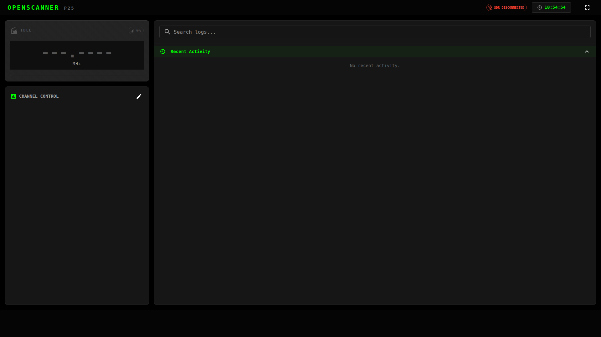

# The dashboard

The dashboard is a single page. The scanner and channel controls are on the left; fire tone-out events and the transmission history are on the right.

{ .screenshot }

## Header

| Item | Meaning |
|---|---|
| SDR READY / SDR DISCONNECTED | Whether the RTL-SDR dongle is detected. Hover for the device name. |
| Clock | Current time. With a GPS fix it shows GPS time and a satellite icon. |
| Volume | Live audio volume for this browser. Click the speaker icon to mute; click again to return to the previous level. |
| UPDATE | A newer release is available. See [Updating](../updating.md). |

The buttons on the right (collapsed into a menu on phones) open:

- **Software Update** — check for and install new releases.
- **Fire Tone Outs** — manage [tone-out alerts](fire-tones.md).
- **Radio Aliases** — name [radio IDs and talkgroups](aliases.md).
- **Settings** — [transcription, SDR tuning, notifications, storage](settings.md).
- **Fullscreen** — handy for a dedicated display.
- **RF Spectrum Debug** and **System Debug** — see [Troubleshooting](../troubleshooting.md#diagnostic-tools).

## Scanner display

The large readout shows what the scanner is doing right now: the channel name and frequency, its mode (**P25**, **DMR**, or **ANALOG** for narrowband FM), the signal strength, and a live view of the audio.

Extra badges appear when relevant:

- The channel's tone, if one is set.
- ! EMERGENCY when a radio signals an emergency.
- ALERT with the tone set's name when a [fire tone-out](fire-tones.md) is detected.

**SKIP** drops the current transmission and moves on, without changing the channel's settings.

## Channel Control

Every channel is listed here with two controls:

- **Hold** — stay on this channel and stop scanning. Press again, or use **Resume** in the header, to go back to scanning.
- **Avoid** — leave this channel out of the scan until you turn avoid off again.

The edit button opens **Manage Channels**. See [Channels](channels.md).

Holds and avoids are shared: change one and every open browser updates.

## Command palette

Press ++ctrl+k++ (++cmd+k++ on a Mac), or click the search icon in the header, and start typing. From the palette you can:

- Hold a channel, or resume from it, by typing its name.
- Resume scanning or skip the current transmission.
- Open channel management, fire tone-outs, radio aliases, settings or the RF debug view.

## History

The right-hand panel lists transmissions as they arrive, and lets you search and replay older ones. See [History and playback](history.md).
