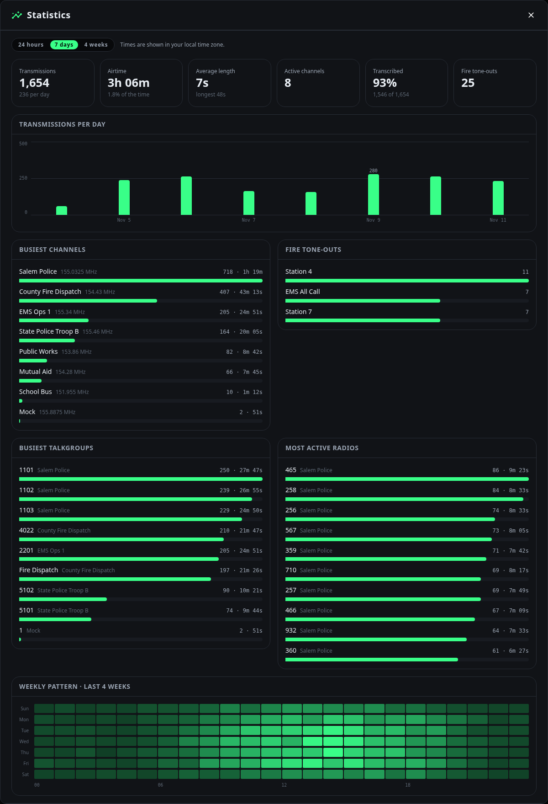

# Statistics

The Statistics page summarises what your scanner has recorded: how much traffic there was, where it came from, and when. Open **Statistics** from the header, or from the [command palette](dashboard.md#command-palette).

{ .screenshot }

## Time range

Choose **24 hours**, **7 days** or **4 weeks** at the top. Everything on the page follows that range except the weekly pattern, which always covers four weeks.

The range is measured back from now, so "7 days" means the last 168 hours, not the last seven calendar days. All times are shown in your browser's local time zone.

## Headline figures

| Tile | What it shows |
|---|---|
| **Transmissions** | How many transmissions were recorded, and the average per day (per hour for the 24-hour range). |
| **Airtime** | Total length of the recorded audio, and the share of the range that was spent receiving. |
| **Average length** | Mean length of a transmission, with the longest one underneath. |
| **Active channels** | How many channels had at least one transmission. |
| **Transcribed** | The share of transmissions that have a [transcript](transcription.md). A low figure usually means transcription is falling behind or failing. |
| **Fire tone-outs** | How many transmissions followed a detected [tone-out](fire-tones.md). |

## Transmissions over time

A bar per day, or per hour for the 24-hour range. Quiet periods are shown as gaps rather than left out, and the busiest bar is labelled. Hover over a bar for its exact count.

Because the range is measured back from now, the first and last bars cover only part of a day or hour.

## Busiest channels, talkgroups and radios

Each list ranks the top ten by number of transmissions, with the count and total airtime beside each bar.

- **Busiest channels** — by channel.
- **Busiest talkgroups** — by talkgroup ID. These only appear for digital systems that send one.
- **Most active radios** — by the transmitting radio's ID.

Talkgroups and radios are shown with the names you gave them in [Radio aliases](aliases.md), with the channel they were heard on alongside. IDs without an alias are shown as numbers.

## Fire tone-outs

How many times each of your [tone sets](fire-tones.md) was detected in the range.

## Weekly pattern

A heatmap of the last four weeks, with a row for each day of the week and a column for each hour of the day. Brighter cells are busier. It shows when your area is typically active — for example, weekday afternoons — which a single day's figures cannot.

It always covers four weeks, whatever range is selected above, so that every weekday is represented equally.

## Notes

- Statistics are computed from the recordings currently in the [history](history.md). Recordings that were deleted, including those removed by [automatic cleanup](history.md#automatic-cleanup), are no longer counted.
- The page loads its figures when you open it or change the range. It does not update live; reopen it to refresh.
