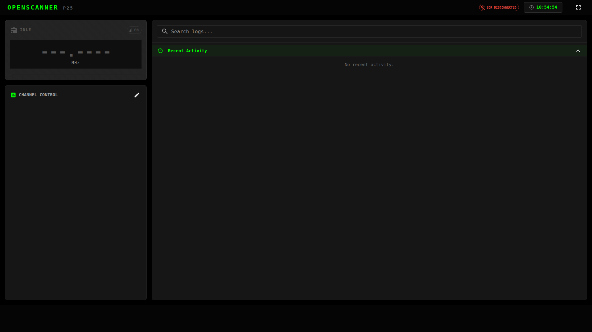

# OpenScanner

OpenScanner turns a Raspberry Pi and an RTL-SDR dongle into a web-based digital radio scanner. It scans your channels, decodes P25, DMR and analog FM, records every transmission, transcribes it with Whisper, and shows it all live in your browser.

{ .screenshot }

## What it does

- **Scans and decodes** P25 and DMR digital voice and narrowband FM.
- **Records and transcribes** every transmission, so you can read back what you missed.
- **Searchable history** by transcript text, channel or frequency, with one-click playback.
- **Fire tone-out alerts** when a two-tone page you care about goes out, optionally pushed to your phone.
- **Live across devices**: holds, avoids and status stay in sync in every open browser.
- **Updates itself** from the web UI.

## Where to start

- **[Install](install.md)**

    One command on a Raspberry Pi or any 64-bit Debian-based machine.

- **[First run](first-run.md)**

    Add your first channel and hear something.

- **[User guide](guide/dashboard.md)**

    What everything on the screen does.

- **[Troubleshooting](troubleshooting.md)**

    No audio, no SDR, no transcripts.

## What you need

| Part | Recommendation |
|---|---|
| **Computer** | Raspberry Pi 5 recommended (Whisper transcription is CPU-heavy). Any 64-bit ARM or x86-64 machine running Raspberry Pi OS, Ubuntu or Debian works. |
| **Radio** | An RTL2832U-based RTL-SDR dongle, such as the RTL-SDR Blog v3 or v4. |
| **Antenna** | One tuned for the bands you listen to, typically 150–800 MHz for public safety. |
| **GPS** *(optional)* | Any USB GPS receiver that works with `gpsd`. |
